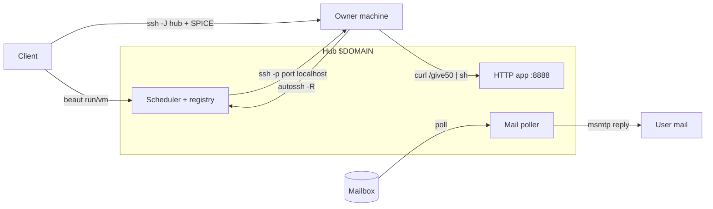

# Requirements

### Overview & Goals

Replace the current `beaut` C + templated-bash project with a **minimalist, pure POSIX/bash bot** whose purpose is to **recycle spare compute by mutualising resources**. One command donates a percentage of a machine; registered users then run remote commands or **graphical VM sessions** on the pooled capacity. `.svr` (a symlinked personal environment) is kept **untouched** and reused as the toolbox (`msmtp`/`send-to-list`, `qemu-install`, `firefox-qemu-run`, `nft_setup.sh`, systemd patterns).

### Scope

**In scope**
- Delete the old implementation: `src/`, `templates/`, `Makefile`, `scripts/build.sh` + `deploy.sh`, old `install.sh`, `config.env*`, and stale `docs/*plan.md`.
- A single bash tool `beaut` with composable roles: **hub** (serves `$DOMAIN`, HTTP app + mail + scheduler), **worker** (donates resources), **client** (submits work). One host may hold several roles.
- HTTP **stats app on `$ADMIN_PORT` (8888)** plus enrollment endpoints (`/give<N>`, `/register`, `/client/<token>`).
- One-line worker enrollment: `curl $DOMAIN/give50 | sh` → persistent **reverse SSH tunnel** to the hub + resource caps.
- **Mail inscription**: poll a mailbox, honour `join@<domain>` (`*` wildcard), reply with a one-time token and client install line; admin approval.
- Client actions: **run a single remote command** and **launch a (graphical) VM session** (QEMU + SPICE over SSH).
- Per-tier resource quotas; one-command deployment.

**Out of scope**
- Any change to `.svr`.
- Kubernetes / K3s / KubeVirt (explicitly dropped in favour of the minimalist bash approach).
- Splitting a single VM across multiple machines (a VM fits on one worker).
- Running a public MTA (inbound mail is polled, not received by an MTA we operate).

### User Stories
- As a **machine owner**, I run `curl $DOMAIN/give50 | sh` so that half my CPU/RAM/disk joins the pool and my owner workload keeps headroom.
- As a **new user**, I mail `join@<domain>` with my SSH public key and get back a token + a one-line client install, so that I can use the pool.
- As a **client**, I run `beaut run <cmd>` to execute a command on a worker, or `beaut vm` to get a graphical desktop session.
- As an **admin**, I see live cluster stats at `http://<hub>:8888/` and approve or reject pending inscriptions.
- As any user, I run **several roles on one box** (e.g. my laptop is both client and worker).

### Functional Requirements
- `GET /` and `/stats` on `:8888` return current stats (worker count, total/free CPU·RAM·disk, active sessions, pending inscriptions) as plain text/JSON.
- `GET /give<N>` returns a shell script that, when piped to `sh`, enrolls the caller donating **N%** of resources.
- `GET /client/<token>` returns the client install script; tokens are single-use.
- Mail poller processes `join@<domain>`, extracts an optional SSH pubkey, issues a token, and replies via `msmtp`.
- Resource tiers: **guest 1 CPU / 2 GiB / 16 GiB**, **registered 4 CPU / 4 GiB / 32 GiB**, **admin = half of an eligible worker's currently-available resources**. A session must fit on a single worker.
- Enrollment, deployment, and client join are each **one command**.

### Non-Functional Requirements
- Pure POSIX/bash; dependencies limited to commonly-available tools (`ssh`/`autossh`, `socat` or `busybox httpd`, `curl`, `qemu`, `mpop`/`fetchmail`, `msmtp`, `systemd-run`/cgroups v2).
- NAT-friendly: workers initiate outbound connections only.
- Donated machines are not trusted with secrets; the owner can always inspect/kill local workloads.

# Technical Design

### Current Implementation

Today the repo builds a C binary (`src/orch.c`, `net.c`, `pngsteg.c`, …) driven by templated bash (`templates/beaut-cli.sh.tmpl`, `beaut-lib.sh.tmpl`) with a signed, encrypted log transport, steganography, and a log-based scheduler (`pick`/`peers_scan`). None of this matches the new mail + HTTP + reverse-SSH model, so it is removed. `.svr` is a **symlink** (see `.gitignore`) and must not be modified; its scripts are invoked, not edited.

### Key Decisions
- **Pure bash, no compiled core** — maximum minimalism, matches `.svr` style.
- **Reverse SSH tunnels** as the single hub↔worker transport — workers run `autossh -N -R 0:localhost:22 tunnel@hub`; the hub execs via `ssh -p <port> <user>@localhost` and clients reach VMs with `ssh -J hub`. One mechanism covers exec and SPICE, and it is NAT-friendly.
- **Mailbox polling** for inbound mail (`mpop`/`fetchmail` on a timer) — no MTA to operate; outbound via `msmtp`/`send-to-list`.
- **Mail-in / token-out / SSH-key** inscription with **admin approval** — `join@<domain>` → one-time token → `curl $DOMAIN/client/<token> | sh`; admin confirms before level ≥ registered.
- **QEMU + SPICE over SSH** for VM sessions, reusing `.svr/usr/bin/qemu-install` and `firefox-qemu-run` (SPICE display, 9p share).
- **Quotas via cgroups v2 / `systemd-run --scope`** (`CPUQuota`, `MemoryMax`) with `qemu -smp/-m` and qcow2 size for VMs; fall back to `nice`/`cpulimit` where systemd is absent.
- **File-based state** (TSV/flat files under a state dir) — no database.

### Proposed Changes

A single dispatcher `bin/beaut` with role-aware subcommands, backed by small sourced libraries under `lib/`. Config lives in `config.env` (copied from `config.env.example`): `DOMAIN`, `ADMIN_PORT=8888`, `ROLES`, mailbox/`msmtp` creds, tunnel user, tier definitions, state dir.

- **HTTP app (`lib/http.sh`)**: a `socat`/`busybox httpd` accept-loop that routes requests. `/` and `/stats` render `lib/stats.sh` output; `/give<N>` renders the worker installer with `N` substituted; `/register` records a worker's reported capacity + tunnel port; `/client/<token>` validates and renders the client installer, burning the token.
- **Worker (`lib/worker.sh`)**: the `give<N>` installer computes N% of CPU/RAM/disk, drops a worker slice, generates an SSH key, POSTs its pubkey + capacity to `/register`, and starts the persistent `autossh` reverse tunnel. A `worker-exec` helper wraps incoming commands in `systemd-run --scope -p CPUQuota=.. -p MemoryMax=..`.
- **Hub scheduler (`lib/hub.sh`)**: reads the worker registry, filters to a worker whose free capacity fits the request's tier, and returns its tunnel port. Rejects/queues sessions that do not fit.
- **VM sessions (`lib/vm.sh`)**: on the chosen worker, launches QEMU via the `.svr` scripts with tier `-smp/-m` and a qcow2 sized to the tier, exposing SPICE on `localhost`; the client connects through `ssh -J hub -L <spice>` and opens the SPICE viewer.
- **Mail (`lib/mail.sh`)**: timer-driven `mpop`/`fetchmail` fetch → parse each message → for `join@<domain>` extract pubkey, create a pending record + one-time token, reply via `msmtp` with the client install line; admins approve by replying/command.
- **Auth (`lib/auth.sh`)**: tokens, pending/approved user records, SSH-key handling, admin list.
- **Deployment**: new `install.sh` performs the one-command bootstrap (install deps, write config, place `beaut` + libs, install and start the `beaut.service` systemd unit for the enabled roles).

### Data Models / Contracts

State files under `$STATE_DIR` (default `/var/lib/beaut`):
- `workers.tsv` — `name  tunnel_port  cpu_pct  cpu_total  mem_free_mib  disk_free_gib  last_seen`
- `users.tsv` — `email  ssh_pubkey  level(guest|registered|admin)  approved_ts`
- `tokens.tsv` — `token  email  created_ts  used(0/1)`
- `sessions.tsv` — `id  user  worker  kind(cmd|vm)  cpu  mem  disk  started_ts`

HTTP contracts:
- `GET /give<N>` → `text/x-shellscript` worker installer (N clamped 1..100).
- `POST /register` body `name&port&cpu_pct&cpu_total&mem&disk` → `200 ok`.
- `GET /client/<token>` → client installer, or `410` if token used/expired.
- `GET /stats` → plain text / JSON snapshot.

Tier table (config, overridable):
```
guest       1 2048  16
registered  4 4096  32
admin       -1 -1  -1    # = half of chosen worker's free CPU/RAM/disk
```

### File Structure
```
bin/beaut                 # dispatcher: roles + subcommands
lib/http.sh               # HTTP accept-loop + routing (:8888)
lib/hub.sh                # worker registry + scheduler
lib/worker.sh             # give<N> enroll, reverse tunnel, caps, exec
lib/vm.sh                 # qemu/SPICE session (wraps .svr scripts)
lib/mail.sh               # poll mailbox, parse join, reply, approve
lib/auth.sh               # tokens, users, ssh keys, admin list
lib/stats.sh              # gather + render stats
lib/common.sh             # config load, state dir, logging helpers
install.sh                # one-command bootstrap
beaut.service             # systemd unit (role-aware)
config.env.example
docs/architecture.md

# removed: src/ templates/ Makefile scripts/build.sh scripts/deploy.sh

# old install.sh config.env config.env.example docs/*plan.md

# untouched: .svr (symlink)

```

### Architecture Diagram


### Risks
- **cgroups v2 availability** varies; provide `nice`/`cpulimit` fallback and detect at enroll time.
- **Reverse-tunnel security**: use a restricted `tunnel` account (forced command / `no-pty` where possible) so donors cannot be abused; owner can kill the slice.
- **Bash HTTP parsing** must reject malformed/oversized requests (`/give<N>` bounds, token validation) to avoid injection.
- **SPICE over SSH latency** on poor links; document SSH tunnel usage, keep it the single supported path.

# Testing

### Validation Approach

All validation is scripted and runnable locally (single host playing all roles via loopback + a local tunnel account), since the tool is pure bash.

### Key Scenarios
- `install.sh` on a clean dir produces a working `beaut` and starts the role(s) without error.
- `beaut hub` serves `:8888`; `curl localhost:8888/stats` returns a stats snapshot and `curl localhost:8888/give50` returns a valid shell script (shellcheck-clean).
- Piping `give50` to `sh` on the same host enrolls a worker: a row appears in `workers.tsv`, the reverse tunnel is up, and `/stats` shows the new capacity.
- `beaut run echo hi` schedules to the worker and returns `hi`; the command runs inside a cgroup/scope honouring the tier quota.
- `beaut vm` launches a QEMU/SPICE session sized to the requester's tier and is reachable through `ssh -J`.
- Mail: a crafted `join@<domain>` message in the polled mailbox yields a pending user, a one-time token, and an outgoing `msmtp` reply (captured via a stub sendmail).

### Edge Cases
- `/give0`, `/give200`, non-numeric N → clamped/rejected.
- Re-using or tampering a token → `410`.
- No worker fits the requested tier → session rejected with a clear message, not a crash.
- Worker disconnects (tunnel drops) → marked stale in `workers.tsv`, excluded from scheduling.
- `join` mail without an SSH key, or from an unknown sender → guest tier / admin-approval path.
- Host without systemd/cgroups → falls back to `nice`/`cpulimit`.

### Test Changes
- Add `tests/` with bash smoke tests for HTTP routing, `give<N>` rendering, token lifecycle, scheduler fit logic, and a mail-parse unit using fixture messages and stubbed `msmtp`.
- Run `shellcheck` over `bin/` and `lib/` as part of the test step.

# Delivery Steps

### * Step 1: Remove old implementation and scaffold the bash bot
The repo contains only the new pure-bash skeleton; `.svr` is untouched and `beaut --help` lists role-aware subcommands.

- Delete `src/`, `templates/`, `Makefile`, `scripts/build.sh`, `scripts/deploy.sh`, old `install.sh`, `config.env`, `config.env.example`, and stale `docs/*plan.md`.
- Add `bin/beaut` dispatcher parsing `ROLES` (hub/worker/client, composable) and routing subcommands.
- Add `lib/common.sh` (config load from `config.env`, `$STATE_DIR` setup, logging) and `lib/auth.sh` (tokens, `users.tsv`, admin list, SSH-key helpers).
- Add `config.env.example` (`DOMAIN`, `ADMIN_PORT=8888`, `ROLES`, mailbox/msmtp creds, tunnel user, tier table), `beaut.service`, and a new one-command `install.sh`.
- Keep `.svr` symlink and its `.gitignore` entry intact.

###   Step 2: Implement the HTTP stats app and enrollment endpoints on :8888
`curl localhost:8888/stats` returns live stats and `/give<N>` returns a valid worker installer.

- Add `lib/http.sh`: a `socat`/`busybox httpd` accept-loop with minimal request parsing and routing.
- Add `lib/stats.sh` gathering worker count and total/free CPU·RAM·disk, active sessions, pending inscriptions; render for `/` and `/stats`.
- Implement `GET /give<N>` (clamp N to 1..100) returning the worker install shell script with N substituted.
- Implement `POST /register` (store worker capacity + tunnel port in `workers.tsv`) and `GET /client/<token>` (validate + burn token, render client installer).
- Harden parsing against malformed/oversized requests and injection.

###   Step 3: Implement worker enrollment, reverse SSH tunnel, and resource caps
Piping `/give<N>` to `sh` enrolls a worker that appears in `/stats` with capped resources.

- Add `lib/worker.sh`: compute N% of CPU/RAM/disk, generate an SSH key, POST pubkey + capacity to `/register`.
- Start a persistent `autossh -N -R 0:localhost:22 tunnel@hub` reverse tunnel and report the allocated port.
- Add a `worker-exec` wrapper running commands via `systemd-run --scope -p CPUQuota=.. -p MemoryMax=..`, with `nice`/`cpulimit` fallback when systemd/cgroups are absent.
- Configure the hub-side restricted `tunnel` account (forced command / no-pty) and mark stale workers on tunnel loss.

###   Step 4: Implement the hub scheduler and remote command execution
`beaut run <cmd>` executes on a fitting worker and returns its output.

- Add `lib/hub.sh`: read `workers.tsv`, filter to a worker whose free capacity fits the requester's tier, return its tunnel port; reject/queue when nothing fits.
- Implement the client `run` subcommand posting the job and streaming results via `ssh -p <port> <user>@localhost -- worker-exec`.
- Record sessions in `sessions.tsv` and enforce per-tier CPU/RAM quotas (guest/registered/admin-half-of-free).
- Return clear errors for no-fit / stale-worker cases.

###   Step 5: Implement graphical VM sessions over SPICE+SSH
`beaut vm` starts a tier-sized QEMU/SPICE desktop on a worker, reachable from the client.

- Add `lib/vm.sh` wrapping `.svr/usr/bin/qemu-install` and `firefox-qemu-run` with tier `-smp`/`-m` and a qcow2 sized to the tier.
- Launch QEMU with SPICE bound to worker `localhost`; register the VM session in `sessions.tsv`.
- Implement the client `vm` subcommand opening `ssh -J hub -L <spice>` and launching the SPICE viewer.
- Enforce one-VM-per-worker fit and tier disk quota; tear down on disconnect.

###   Step 6: Implement the mail inscription system
A `join@<domain>` message yields a pending user, a one-time token, and an emailed client install line.

- Add `lib/mail.sh`: timer-driven `mpop`/`fetchmail` fetch into a Maildir and parse new messages.
- Handle `join@<domain>` (`*` wildcard): extract optional SSH pubkey, create pending user + one-time token in `tokens.tsv`/`users.tsv`.
- Reply via `msmtp`/`send-to-list` with the token and `curl $DOMAIN/client/<token> | sh` line.
- Add admin approval (admin-list mail command or reply) that promotes a user to the registered tier; wire the poller into `beaut.service`.